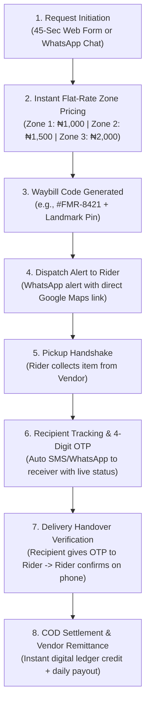

# OrchidByte Solutions — Revised Project Strategy & Product Blueprints

> **Document Purpose**: Strategic roadmap, market viability analysis, and detailed product specifications for software projects engineered specifically for the Nigerian market, with immediate operational focus on **SchoolSync** (Live Production) and **Fimrash Logistics Services** (Intra-State Kano Metropolis MVP).

---

## 1. Executive Strategy & Market Alignment

### 1.1 The Pivot to High-Utility Nigerian Software
Earlier portfolio iterations featured generic, enterprise-heavy systems (e.g., continuous penetration testing platforms, ISP fiber telemetry dashboards, state-level government asset tracking). While technically complex, these products suffered from:
* **Procurement Bottlenecks**: State MDAs and large ISPs have 6–18 month procurement and committee approval cycles.
* **Over-Engineering**: Nigerian SMEs operate primarily via WhatsApp, phone calls, and cash/instant bank transfers, not heavy desktop dashboards.
* **High Customer Friction**: Forcing Nigerian customers or riders to download 40MB+ mobile apps leads to immediate drop-off due to storage and mobile data constraints.

### 1.2 Core Product Principles for Nigerian Market Dominance
Every system engineered by OrchidByte Solutions must adhere to four non-negotiable principles:
1. **Zero-App-Download for Consumers**: Leverage progressive web apps (PWAs), mobile-first web links, and WhatsApp Cloud / Termii APIs.
2. **Landmark-Aware Navigation**: Address the reality that Nigerian cities (particularly Kano) use landmarks, known junctions, and mosques rather than formal street numbers.
3. **Bulletproof Cash & Payment Handshake**: Incorporate automated Cash-on-Delivery (COD) reconciliation ledgers and instant bank transfer verification.
4. **Immediate Economic ROI**: The system must demonstrably save the business owner cash, eliminate employee theft, or automate manual hours within the first 30 days.

---

## 2. Live Flagship: SchoolSync Management Platform

### 2.1 Overview & Live Deployment
* **Product Name**: SchoolSync Management Suite
* **Live Production URL**: [https://schoolsync.orchidbyte-solutions.com.ng](https://schoolsync.orchidbyte-solutions.com.ng)
* **Demo Access Credentials**:
  * **Email**: `demo.admin@school.com`
  * **Password**: `demo.admin@school.com`
* **Target Audience**: Private primary, secondary, and comprehensive schools across Nigeria (Kano, Kaduna, Abuja, Lagos).

### 2.2 Core Operational Capabilities
1. **Terminal Grading & Result Broad-sheets**:
   * Eliminates the end-of-term manual grading bottleneck where teachers spend weeks compiling paper score sheets.
   * Auto-computes student averages, class rankings, grade remarks, and generates printable PDF report cards with school crests.
2. **Fee Tracking & Bursary Reconciliation**:
   * Tracks tuition fee schedules, uniform payments, and development levies.
   * Automated SMS receipts and pending fee reminders sent directly to parents via integrated Nigerian SMS gateways (Termii).
   * Direct online fee payment reconciliation via Flutterwave / Paystack.
3. **Student & Staff Attendance Ledger**:
   * Real-time daily classroom attendance tracking with instant notification to parents for absent students.
4. **Progressive Web App (PWA) Architecture**:
   * Offline-capable app shell that functions seamlessly on low-end smartphones and tablets under erratic network connections.

---

## 3. Immediate Development Target: Fimrash Logistics Services Platform

### 3.1 Background & Founder Advantage
* **Target Venture**: **Fimrash Logistics Services** (Kano, Nigeria)
* **Strategic Position**: OrchidByte leadership co-founded Fimrash Logistics, providing a live operational sandbox and immediate internal client demand to test, refine, and deploy the system before commercial white-label distribution.
* **Geographic Scope**: Kano Metropolitan Area (*Kano Municipal, Fagge, Dala, Gwale, Nassarawa GRA, Tarauni, Zoo Road, Farm Centre, Hotoro, Sharada Industrial, Rijiyar Zaki, BUK Old & New Campuses*).

### 3.2 The Core Problem in Kano Metro Logistics
1. **Communication Fatigue**: Customer calls the business $\rightarrow$ dispatcher calls the rider $\rightarrow$ rider calls the customer 5 times asking for directions (*"Wane layin ne? Kusa da wane masallaci?"*).
2. **Rider Theft & Handover Disputes**: Riders claim parcels were delivered to someone at the gate, while recipients claim they never received them.
3. **Cash-on-Delivery (COD) Leaks**: Social commerce vendors (selling abayas, cosmetics, electronics) rely on dispatch riders to collect cash on arrival. Riders frequently delay remittances, mix customer funds with personal money, or dispute amounts collected.
4. **Unpredictable Pricing**: Haggling over delivery costs creates friction and mistrust between vendors and dispatchers.

### 3.3 The Fimrash Metro Delivery Flow



### 3.4 Key System Specifications
1. **Frictionless Multi-Channel Booking**:
   * **Mobile Web Form (`fimrash.ng` or sub-portal)**: No login required. Sender enters:
     * Sender Name & Phone
     * Pickup Area (Dropdown of Kano hubs) + Known Landmark (*e.g., "Kwari Market, Line 3, Near Central Mosque"*)
     * Receiver Name & Phone
     * Delivery Area + Known Landmark (*e.g., "Nassarawa GRA, Behind Tahir Guest Palace"*)
     * Parcel Type (*Fabric/Fashion, Electronics, Food/Catering, Documents*)
     * Cash to Collect (COD Amount, if applicable)
   * **WhatsApp Bot / Quick Booking Link**: Generates a pre-filled dispatch request string sent directly to the Fimrash WhatsApp business desk.
   * **Internal Dispatcher Desk**: Fast 15-second entry screen for orders received via direct voice calls from traditional traders.
2. **Transparent Zone Pricing Engine**:
   * **Zone 1 (Inner Commercial Core)**: *Kano Municipal, Fagge, Dala, Gwale, Nassarawa GRA, Sabon Gari* $\rightarrow$ **₦1,000 – ₦1,200**
   * **Zone 2 (Outer Metropolitan)**: *Zoo Road, Tarauni, Hotoro, Sharada Industrial, Rijiyar Zaki* $\rightarrow$ **₦1,500**
   * **Zone 3 (Perimeter / Campuses)**: *BUK New Site, Ungogo, Kumbotso, Jaba, Zawaciki* $\rightarrow$ **₦2,000 – ₦2,500**
3. **The Anti-Theft Handover OTP**:
   * When an item is picked up, the system generates a random 4-digit code (e.g., `7214`) sent **exclusively to the recipient's phone via SMS/WhatsApp**.
   * The rider cannot mark the delivery complete without obtaining and entering this 4-digit code.
   * Prevents riders from dumping packages with unauthorized third parties or falsely claiming delivery.
4. **Daily COD Reconciliation Ledger**:
   * Real-time dashboard showing: Total Cash Collected by Rider, Delivery Fees Earned, and Net Payable to Vendor.
   * One-click automated settlement summary via Moniepoint/OPay/Bank transfer at 6:00 PM daily.

---

## 4. Four Complementary Nigerian Market Solutions

Beyond SchoolSync and Fimrash Logistics, the following 4 solutions represent high-utility, simple-to-build projects tailored to Nigerian commercial trends:

### 4.1 Project 3: EstatePass NG — Gated Community Access & Dues Portal
* **Market Reality**: Gated residential communities and GRA neighborhoods (Abuja, Lagos, Kano) rely on physical paper logbooks at security gates. Gate guards argue with visitors, and residents default on monthly security and sanitation dues.
* **The Solution**:
  * Resident generates a 6-digit visitor access code or QR code via web/WhatsApp and shares it with the guest.
  * Gate security officer inputs the code on a mobile web interface to verify guest identity and log entry/exit.
  * Automated monthly dues invoicing with Paystack payment links and automated WhatsApp debt reminders.
* **Target Buyers**: Estate Resident Development Associations (RDAs), property managers, serviced apartment operators.

### 4.2 Project 4: PharmTrack / MediStock — Community Pharmacy Expiry & Stock Manager
* **Market Reality**: Independent pharmacies and private clinics lose substantial revenue to expired drugs left unnoticed on back shelves and experience inventory shrinkage from attendant theft.
* **The Solution**:
  * Simple batch recording of incoming medicine stock with manufacture and expiry dates.
  * Automatic warning alerts for medications expiring in 90, 60, and 30 days, enabling timely discounts or returns to pharmaceutical distributors.
  * Daily cash-vs-stock reconciliation summary dispatched to the owner's WhatsApp every evening.
* **Target Buyers**: Community pharmacy owners, private clinics, patent medicine stores.

### 4.3 Project 5: WaybillQR (Inter-State) — Inter-State Goods & Haulage Parcel Tracker
* **Market Reality**: Commercial traders at mega-markets (Kantin Kwari, Singer, Alaba, Onitsha) ship goods via inter-state luxury buses and commercial parks using handwritten paper manifests that frequently get lost or disputed.
* **The Solution**:
  * Generates digital waybills with scannable QR labels.
  * Receivers receive automatic SMS notifications when goods depart the departure park and arrive at the destination depot.
  * Requires receiver verification before park attendants release high-value goods.
* **Target Buyers**: Commercial transport companies, inter-state park unions, high-volume wholesale traders.

### 4.4 Project 6: CoopLedger — Staff Cooperative & Ajo/Esusu Contribution Tracker
* **Market Reality**: Staff cooperatives at universities, teaching hospitals, government ministries, and trade unions manage millions in monthly contributions using fragile, disputed Excel sheets or physical paper cards.
* **The Solution**:
  * Member dashboard showing monthly contributions, loan repayments, and accrued interest.
  * Batch CSV deduction upload with instant SMS payment receipts sent to every member.
  * Multi-stage loan application and committee approval workflow.
* **Target Buyers**: Institutional staff cooperatives, market trade unions, mutual aid societies.

---

## 5. Website Portfolio Realignment Plan

To maintain absolute credibility, the OrchidByte Solutions public portfolio is realigned as follows:

```
┌────────────────────────────────────────────────────────────────────────┐
│                   PUBLIC PORTFOLIO REALIGNMENT                         │
├──────────────────────────┬───────────────────────┬─────────────────────┤
│ Project Name             │ Status                │ Public Link / Proof │
├──────────────────────────┼───────────────────────┼─────────────────────┤
│ 1. SchoolSync Management │ LIVE PRODUCTION       │ schoolsync.         │
│    Suite                 │ (Flagship Deployed)   │ orchidbyte-         │
│                          │                       │ solutions.com.ng    │
│                          │                       │ [Demo Credentials]  │
├──────────────────────────┼───────────────────────┼─────────────────────┤
│ 2. Fimrash Logistics     │ PILOT MVP             │ Private Beta        │
│    Services Platform     │ (Active Kano Metro    │ (Kano Metropolitan  │
│                          │ Rollout)              │ Deployment)         │
├──────────────────────────┼───────────────────────┼─────────────────────┤
│ 3. Custom Systems &      │ CLIENT CONTRACTS      │ Request Discovery   │
│    Architecture On-Demand│ (Architecture & QA)   │ Discovery Session   │
└──────────────────────────┴───────────────────────┴─────────────────────┘
```

* **Action Completed**: Removed all abstract, unverified template projects (*GovTrack*, *NetWatch*, *CyberShield NG*, *HelpDesk Pro*) from public facing portfolio pages.
* **Action Completed**: Integrated verified live production link and demo credentials for SchoolSync.
* **Action Completed**: Featured Fimrash Logistics Services as the active flagship pilot project.

---
*Authored by Antigravity Engineering for OrchidByte Solutions & General Services (CAC BN: 9343571).*

